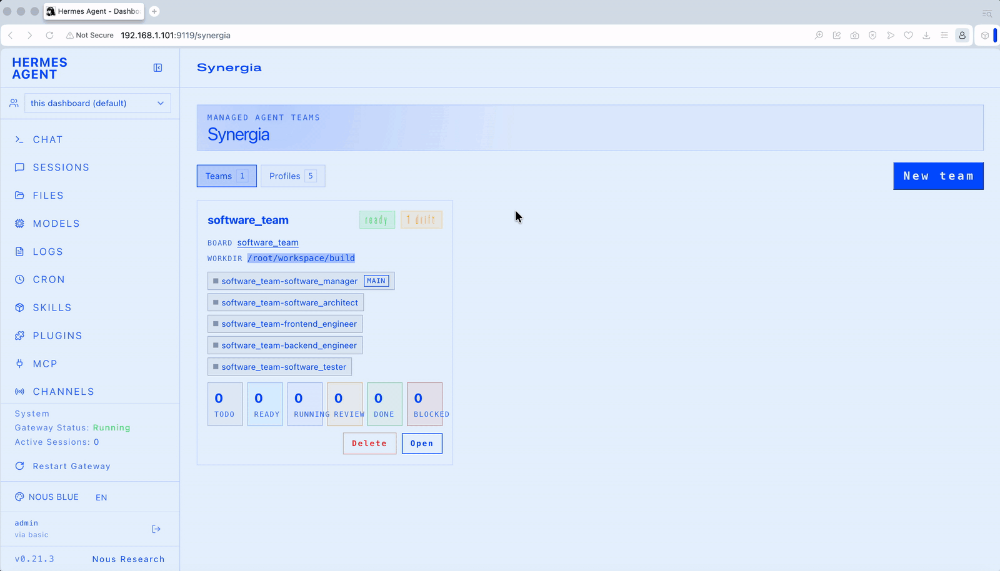

# Synergia — Teams for Hermes Agent

**hermes-agent-synergia** is a [Hermes Agent](https://github.com/NousResearch/hermes-agent) plugin that turns a set of Hermes profiles into a **team**. A team groups profiles with roles, binds them to one Kanban board and one shared work directory, keeps that binding reconciled, and keeps team agents working inside it.

It ships three surfaces over one Python core:

- **`hermes team` CLI**: create, clone, sync, and operate teams, and work the human-approval inbox.
- **`team` toolset**: ten agent tools that let an orchestrator route work across its team.
- **Synergia dashboard tab**: chat with a team, watch its board, answer what it asks, review artifacts, and manage teams and profiles.

| | |
|---|---|
| Plugin version | 1.2.0 (`src/plugin.yaml`) |
| Dashboard version | 0.7.0 (`src/dashboard/manifest.json`) |
| Plugin API | `manifest_version: 2`, `api_version: 1` |
| Runtime dependencies | stdlib + PyYAML (already a Hermes dependency) |
| License | MIT |

---

## Requirements

- A [Hermes Agent](https://github.com/NousResearch/hermes-agent) installation.
- Python 3 with PyYAML (provided by Hermes).
- `git`, for the `worktree` workspace policy and for merging thread results.
- For the dashboard: the Hermes web dashboard (FastAPI/uvicorn, the substrate's `[web]` extra).

---

## Installation

The plugin loads as a directory package. `src/` is the plugin directory.

1. Link the plugin into the Hermes root plugins directory (default root: `~/.hermes`):

   ```bash
   ln -s "$(pwd)/src" ~/.hermes/plugins/hermes-agent-synergia
   ```

2. Enable the plugin in the root `config.yaml`:

   ```yaml
   plugins:
     enabled:
       - hermes-agent-synergia
   ```

3. Confirm that the plugin loads and the registry is healthy:

   ```bash
   hermes team doctor
   ```

You do not need to link the plugin into each member profile yourself. When the plugin instantiates or reconciles a member, it creates the per-profile symlink `<profile>/plugins/hermes-agent-synergia` and adds the plugin to that profile's `plugins.enabled`.

> Install the plugin as a **user** plugin only. Do not install it as a project plugin (`./.hermes/plugins/`).

---

## Demo



---

## Contributing

Contributions are welcome: bug reports, fixes, new features, and new sample profiles.

## License

Licensed under the [MIT License](LICENSE). By contributing, you agree that your contributions are licensed under the same terms.
